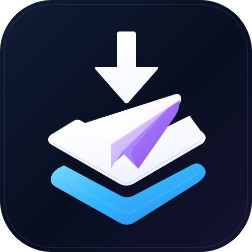
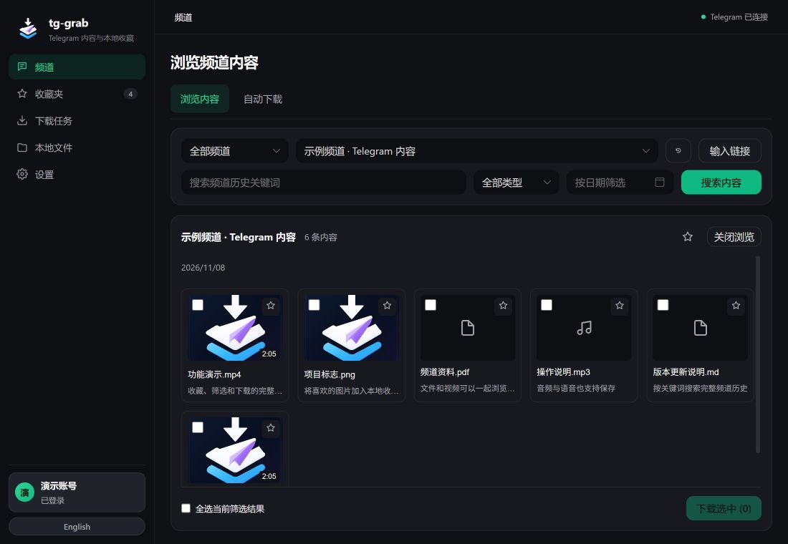
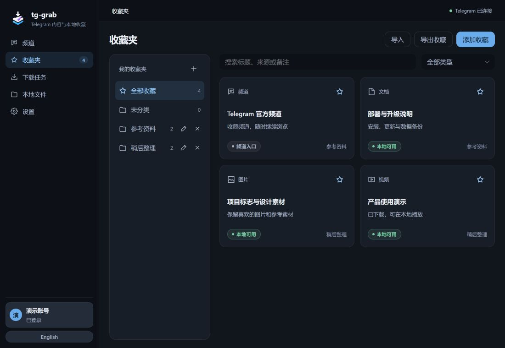

<p align="center">
  
</p>

<h1 align="center">tg-grab</h1>

Download Telegram media and organize local collections. Available as a Windows desktop app and a self-hosted Web app.

[中文说明](README.md) · [Download Windows preview](https://github.com/R051/tg-grab/releases) · [Docker setup](#docker) · [Changelog](CHANGELOG.md)

[](https://github.com/R051/tg-grab/actions/workflows/ci.yml)
[](https://github.com/R051/tg-grab/releases)
[](LICENSE)

## Windows

1. Download the **Windows x64 installer** from [Releases](https://github.com/R051/tg-grab/releases). `SHA256SUMS` is provided alongside it.
2. Install and open tg-grab. In the bottom-left account entry, enter your own [Telegram API credentials](https://my.telegram.org/apps) and sign in.
3. Choose a joined channel, search its history and select media to download, or paste message links into Downloads.

The first release is a preview and is not code-signed. The installer supports English and Simplified Chinese. Reinstalling keeps the application data; export collections from Settings before upgrading if you want a separate metadata backup.

Open **Settings → About** for the author, installed version, repository, release downloads, issue reporting and changelog.

## What it does

- Select joined channels directly, including filters based on your Telegram folders.
- Search media across channel history by keyword, type and optional day.
- Download video, photos, audio and documents; manage a queue and monitor new channel posts.
- Organize favorites into local folders with notes and JSON import/export.
- Browse local files separately, preview downloaded media, and seek through videos in the Web app.
- Choose a download directory, media rules and folder layout. On desktop, choose whether closing the window asks, minimizes to the tray or quits.





*Screenshots use demonstration data, not a real Telegram account.*

## Docker

The published image is **Linux amd64**: `ghcr.io/r051/tg-grab`. The Web app and backend are included in the same image.

```sh
git clone https://github.com/R051/tg-grab.git
cd tg-grab
docker compose pull
docker compose up -d --no-build
docker compose logs tg-grab
```

Open `http://localhost:8080` and enter the access token printed in the logs. Configure your Telegram account in the Web UI. On another computer, use the server's address instead of `localhost`.

| Tag | Purpose |
| --- | --- |
| `preview` | Current preview channel; used by Compose by default |
| `0.1.2` | Fixed current-preview version |
| `sha-<commit>` | Image built from a specific source commit |

To pin a version, set `TG_GRAB_IMAGE=ghcr.io/r051/tg-grab:0.1.2` in a local `.env` file. To update the selected channel, run `docker compose pull` followed by `docker compose up -d --no-build`.

To build from source instead:

```sh
docker compose up -d --build
```

All configuration, Telegram sessions, collections and downloads stay in the mounted `./data` directory. Keep it when upgrading. In the Web edition, download paths refer to the server; use the file action to save a copy to your browser device. Use an HTTPS reverse proxy when exposing the service beyond a trusted network.

## Collections and files

Saving a favorite stores a source link, folder, notes and optional local-file reference; it does not download media. Collection exports exclude media bytes, Telegram sessions, API Hash and Web access tokens. Imports merge entries while preserving existing notes.

Removing a folder moves its favorites to Unfiled. Removing a favorite keeps its file. Deleting a local file keeps the favorite and source link. Changing the download directory does not move existing files; references to a previous root show as unavailable.

Stopping history loading retains results. Closing browsing clears the current channel. Both leave queued downloads running.

## Build and contribute

Use **Node.js 22.12+**, stable Rust, and the platform's native build tools. Windows needs Microsoft C++ build tools and WebView2.

```sh
npm ci
npm run check:version
npm test
npm run build
npm run tauri dev
npm run tauri build -- --bundles nsis
```

For a local Web server:

```sh
cargo run --release --manifest-path src-tauri/Cargo.toml --bin tg-grab-server --no-default-features --features server
```

See [CONTRIBUTING.md](CONTRIBUTING.md) for automated checks, installer verification and version publishing. Dependency updates are proposed weekly; the pinned grammers revision is reviewed separately.

The project uses Rust, Tauri v2 and Vue 3. It connects to Telegram MTProto through [grammers](https://github.com/Lonami/grammers), rather than another downloader's API.

## Support and limits

- [Report a bug or suggest a feature](https://github.com/R051/tg-grab/issues/new/choose). Include the version and whether you use desktop, Web or Docker; remove credentials and personal information from logs.
- Your own Telegram API credentials and account access are required. The session is stored locally. Do not use leaked/shared credentials.
- Automatic download rules apply to monitoring and catch-up; explicitly selected media can still be downloaded.
- Short Telegram rate limits are handled automatically; longer waits are reported so you can retry later.
- Published desktop installers currently target Windows x64. macOS and Linux desktop builds are not verified.
- Use the tool for content you may access and respect creators, copyright and Telegram's terms. Do not redistribute other people's content without permission.

## License

[MIT](LICENSE)
