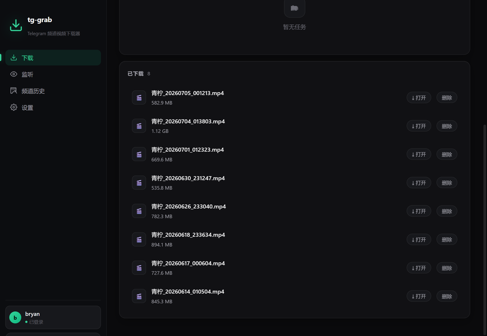

# tg-grab

[中文说明](README.zh-CN.md)

A native desktop app to download videos from Telegram channels and groups — built with **Rust + Tauri v2 + Vue 3**.



## Features

- **📥 Manual downloads** — paste one or many `t.me` message links, with a live progress bar
- **📡 Watch mode** — subscribe to channels/groups and new videos are downloaded automatically
- **🎞 History browser** — page through a channel's video history and pick exactly what you want
- **Partial-file safety** — interrupted or rate-limited downloads are detected by size and re-downloaded cleanly
- **Gentle by design** — sequential queue (configurable 1–4 workers), automatic flood-wait handling
- **Bilingual UI** — 中文 / English, dark theme
- **True native app** — single installer, no Python/Node runtime required

## Build

Prerequisites: [Rust](https://rustup.rs/), Node.js 18+, and on Windows the [WebView2 runtime](https://developer.microsoft.com/microsoft-edge/webview2/) (preinstalled on Win 10/11).

```bash
npm install
npm run tauri dev     # development
npm run tauri build   # release installer (NSIS/MSI)
```

## Web server + Docker

The same binary codebase also runs as a **web server** — access the full UI from any browser (NAS / home server / VPS):

```bash
# local run (frontend must be built once: npm run build)
cd src-tauri
cargo run --release --no-default-features --features server
# → prints the access token, UI at http://0.0.0.0:8080

# or with Docker
docker compose up -d
```

- The access token is auto-generated on first boot and printed to the console (also stored in `data/config.json`). Enter it once in the browser — it is kept in localStorage.
- All downloads, config and the Telegram session live in the mounted `/data` volume.
- Put it behind a reverse proxy (Caddy/nginx) for HTTPS if exposing beyond your LAN.

## Getting API credentials

tg-grab speaks MTProto with your own Telegram account, so it needs **your** API credentials:

1. Open <https://my.telegram.org/apps> and sign in
2. Create an app and copy the **API ID** and **API Hash**
3. Enter them in tg-grab's Settings tab (stored locally in the app data folder, never synced)

> Don't use leaked/shared api_ids floating around the internet — Telegram actively blocks them, and your account may be affected.

## Notes & limits

- First run requires a one-time login (phone + code + optional 2FA password). The session is stored locally (`app data dir/tggrab.session`).
- Downloading content you can already see in your own client is fine; respect copyright and Telegram's ToS.
- Rate limits (FLOOD_WAIT) are handled automatically for short waits; long waits fail the task with a clear message — retry later.
- Linux/macOS builds are untested but should work via standard Tauri cross-platform flow.

## License

[MIT](LICENSE)
